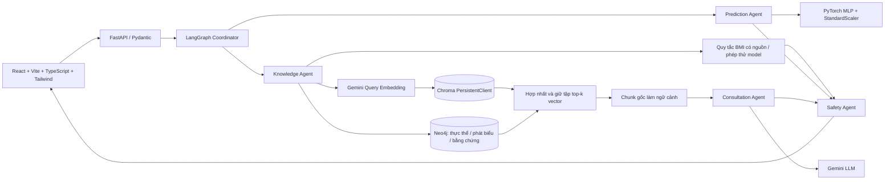
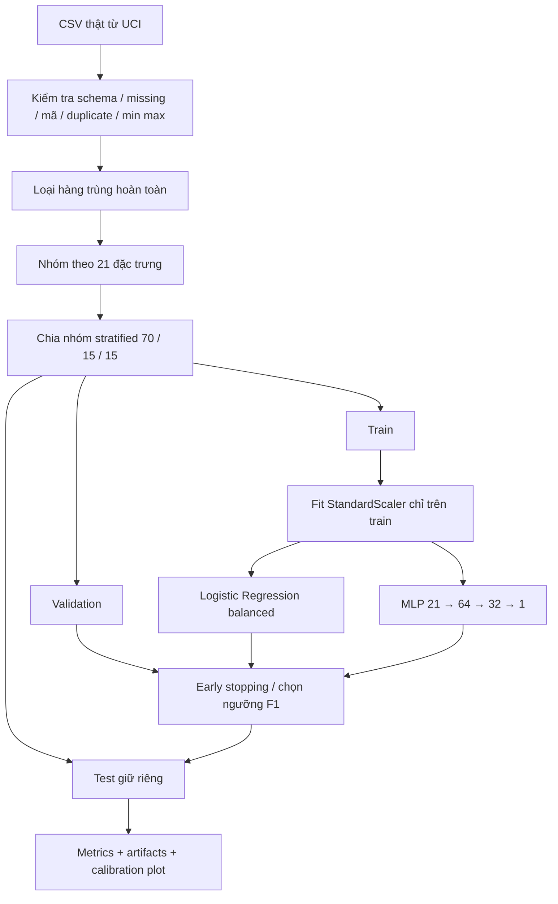
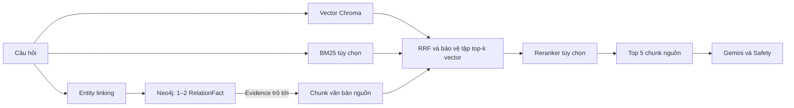
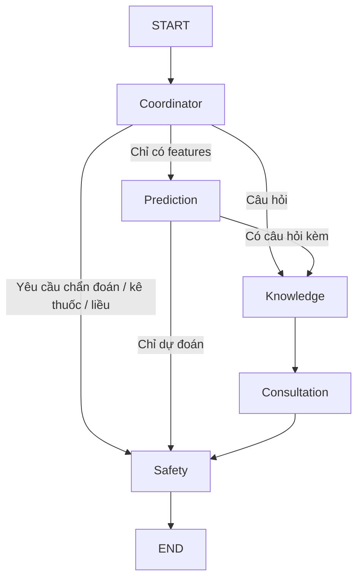

# Kiến trúc hệ thống

Đối chiếu lại ngày **05/11/2026** với code, `.env` local và báo cáo nâng cấp.
Cấu hình local dùng **vector + Neo4j**;
mẫu `.env.example` vẫn tắt các nhánh nâng cao cho máy mới.

## Tổng thể

Tất cả agent là node trong một backend; không có microservice riêng hay LLM local.
Frontend không giữ API key, dùng Fetch và state React. Không có database bệnh án.
Kho kiến thức hiện có **6 bài NIDDK, 67 chunk**. Neo4j lưu **37 thực thể, 38 phát
biểu, 40 bản ghi bằng chứng**; chưa có tài liệu wiki được xuất bản. BM25 và bước
chấm lại thứ hạng đã có code nhưng đang tắt. Neo4j là dịch vụ database riêng;
các agent vẫn chạy chung trong FastAPI.

Bản cập nhật thêm công cụ trước–sau, so sánh LR/MLP, đọc báo cáo ảnh hưởng,
thống kê CSV và đồ thị trong React. Quy tắc BMI đọc nguồn cục bộ đã xác minh;
trace ghi `sourced_rule`, không mô tả là kết quả truy vấn Neo4j hoặc Gemini.
Phép thử model ghi `model_scenario`. Nhánh RAG thông thường giữ luồng cũ.
Hồ sơ được giữ trong bộ nhớ tab và gửi theo request khi người dùng chọn;
workflow backend không giữ hồ sơ cá nhân dùng chung. Chi tiết và giới hạn:
[development_upgrade.md](development_upgrade.md).

## API và phân lớp code

`backend/api/routes.py` nhận schema từ `backend/schemas/`; logic model trong
`backend/ml/`, retrieval trong `backend/rag/`, provider trong `backend/llm/`,
agent trong `backend/agents/`, đồ thị trong `backend/graph/`.
`backend/core/` chứa cấu hình `.env` và lỗi dịch vụ an toàn.
`backend/graph/` là luồng điều phối LangGraph; đồ thị kiến thức Neo4j thuộc
`backend/rag/neo4j_*.py`. Hai phần không phải cùng một loại đồ thị.

`/predict` suy luận trực tiếp; `/chat` và `/analyze` gọi workflow.
`/model-info` kiểm tra artifact thật. `/health` chỉ kiểm tra backend.
Các đường dẫn trên có tiền tố `/api/v1`, riêng `/health` ở gốc.
`GET /api/v1/retrieval-info` đọc cấu hình/snapshot local;
`GET /api/v1/graph/stats` truy vấn Neo4j thật.
`POST /api/v1/retrieve` trả bằng chứng và trace, không sinh câu trả lời bằng LLM.
Validation lỗi trả tên trường, không echo input. Log chỉ request ID, status, thời gian,
loại lỗi; không log câu hỏi, features hoặc exception text của provider.
Lời gọi blocking dùng endpoint đồng bộ để FastAPI chạy trong threadpool.

## Deep Learning

Các nhóm có cùng features nhưng khác nhãn được stratify theo nhãn lớn nhất của nhóm,
giữ toàn bộ nhóm cùng tập. Vì vậy số hàng từng tập xấp xỉ 70/15/15; tỷ lệ lớp được ghi
thực tế trong metrics. Dropout 0,2 sau tầng 64. BCEWithLogitsLoss có pos_weight từ train,
Adam, batch 512, seed 42, CPU bốn thread, patience 5. Sigmoid chỉ khi suy luận.
Chọn checkpoint theo validation loss và threshold theo F1 validation; không dùng test
để điều chỉnh. Logistic Regression dùng cùng split và scaler.

Artifacts đi kèm version; loader kiểm tra thứ tự 21 features và version của schema,
threshold/config trước khi load. Model dùng `weights_only=True`, CPU và inference_mode.
Cache model trong process, không tải lại mỗi request; cần restart sau train mới.

## Custom RAG indexing

`ingestion/download_sources.py` tải nguồn NIDDK trong manifest, hỗ trợ chọn document ID,
chọn nội dung chính,
loại ảnh/logo/điều hướng đã nhận diện và lưu nguồn gốc/checksum. Giữ tham khảo trong
aside, caption, cấp heading và cấu trúc bảng. Có thể import PDF có text, DOCX, TXT
UTF-8 hoặc Markdown bằng manifest. DOCX đọc trực tiếp paragraph/bảng theo thứ tự.
Văn bản nguồn được coi là dữ liệu, không được thực thi.

`document_loader → text_cleaner → chunker → EmbeddingService → VectorStore`.
Chunker theo heading/câu, ước lượng một token trên bốn ký tự, mục tiêu 500 token,
overlap tối đa 50 token bằng câu nguyên vẹn. Heading ngắn tạo chunk ngắn; không cắt
câu dài hoặc bảng để đạt kích thước cứng. Chưa dùng tokenizer Gemini thật.
Giữ đoạn văn và đường dẫn heading lồng nhau; chú thích xét nghiệm đi cùng bảng.

Embedding `gemini-embedding-001`, 768 chiều, task RETRIEVAL_DOCUMENT, chuẩn hóa L2.
Collection lưu model/dimension; truy xuất dùng cùng cấu hình, task RETRIEVAL_QUERY.
Mỗi chunk có ID xác định từ nội dung, document ID, section và thứ tự; metadata có
title/section/source URL và source_type/section_path. Tài liệu có nội dung/metadata
chunk không đổi được bỏ qua trước khi gọi embedding. Re-index upsert trước, sau đó
xóa các chunk cũ của chính tài liệu đó. `--check-only` chỉ chạy loader/chunker offline.
Không có transaction nhiều tài liệu; báo thành công/lỗi từng document.
PDF có trang thiếu text bị từ chối để kiểm tra/OCR; không bật OCR mặc định.
Phạm vi parser và kết quả kiểm chứng: [ingestion.md](ingestion.md).

## Retrieval và sinh trả lời

Sơ đồ sau mô tả nhánh vector cơ bản khi tắt các tính năng nâng cao. Nhánh đang
dùng trên máy local bổ sung Neo4j và hợp nhất như sơ đồ tiếp theo bên dưới.

```mermaid
flowchart LR
  Q[Câu hỏi] --> N[Chuẩn hóa khoảng trắng]
  N --> EMB[Query embedding]
  EMB --> SEARCH[Chroma cosine / top k=5]
  SEARCH --> FILTER[Lọc metadata lỗi / distance > 0.65]
  FILTER --> CTX[Khử trùng / context 14000 ký tự / ID S1...]
  CTX --> CAT[Đánh mã các đoạn bằng chứng trong context]
  CAT --> GEN[Gemini trả JSON claims + mã đoạn được chọn]
  GEN --> QUOTE[Backend lấy quote nguyên văn theo mã đoạn]
  QUOTE --> SAFE[Kiểm tra ID / quote / số liệu / quy tắc an toàn]
  SAFE --> ANS[Tiếng Việt + nguồn thật hoặc fallback]
```

Provider gửi `response_json_schema` từ Pydantic thay vì `response_schema` để tránh
bộ chuyển schema cũ của SDK từ chối `additionalProperties` ở các trường dictionary.
JSON nhận về vẫn được Pydantic xác thực chặt trước khi kiểm tra nguồn.

Gemini chọn `supporting_passage_ids` như `S1.P2`, không tự chép quote. Backend
chỉ chấp nhận mã thuộc context của yêu cầu hiện tại rồi lấy lại văn bản gốc.
Nếu một nhận định chọn nhiều đoạn trong cùng chunk, quote là khoảng liên tục
từ đoạn đầu tới đoạn cuối, giữ cả nội dung ở giữa. Mã lạ hoặc trùng bị từ chối.
Bản nháp chuyển tới Safety vẫn dùng `citation_ids` và `supporting_quotes`;
API, chunking, embedding và các chỉ mục không thay đổi. Đây chỉ là đánh mã
đoạn trong context sau truy xuất, không phải chia chunk hoặc index lại tài liệu.

LLM không tự tạo URL. Citation links dựng từ metadata đã kiểm tra, chỉ trả các nguồn
được claim sử dụng. Validator yêu cầu quote xuất hiện trong chunk, số liệu có trong quote,
không có ID lạ/URL tùy ý. Đây là kiểm tra cấu trúc và một phần nội dung, **không phải
chứng minh entailment ngữ nghĩa** giữa claim tiếng Việt và nguồn tiếng Anh.
Do quote được lấy trực tiếp từ nguồn, quote hợp lệ càng không thể được dùng
làm bằng chứng độc lập rằng Gemini đã chọn đúng đoạn cho nhận định.

System instruction tách EVIDENCE/QUESTION/MODEL_OUTPUT bằng JSON, yêu cầu bỏ qua chỉ dẫn
trong dữ liệu, không kê thuốc/chẩn đoán. Không có tool execution cho nội dung retrieval.
Prompt injection vẫn cần đánh giá live; rule-based safety không bảo đảm phát hiện tất cả.
GraphRAG dùng Neo4j Community làm backend lưu trữ/truy vấn chính. NetworkX giữ để
đối chiếu/rollback. Cấu hình local chọn vector + Neo4j với fusion `vector_guarded`;
BM25 và reranker giữ tắt vì chưa đạt gate. Nhánh mới dùng snapshot corpus/graph/BM25/Chroma cùng phiên bản,
có kiểm tra checksum/quote/version và fallback vector. Wiki là nguồn nền có revision,
hiện chưa import được do API trả 403. Không triển khai Microsoft GraphRAG đầy đủ.
Neo4j dùng RelationFact/Evidence riêng, ID vật lý theo snapshot; migration phải
kiểm chứng xong trước khi đổi con trỏ active. Driver dùng chung theo process và
đóng qua FastAPI lifespan; lỗi graph có trace và fallback vector/BM25. Chi tiết:
[neo4j_demo.md](neo4j_demo.md). Báo cáo trước migration: [rag_upgrade.md](rag_upgrade.md).

Graph tìm bằng chứng bằng quan hệ có kiểu; LangGraph vẫn chỉ điều phối workflow.
Hai đồ thị có vai trò khác nhau. LLM đọc chunk gốc, không được biến đường đi hai
bước thành một quan hệ nhân quả mới.
Mỗi nhánh lấy tối đa 15 ứng viên theo cấu hình mặc định; cuối cùng chọn tối đa
5 chunk, rồi lọc theo ngân sách ngữ cảnh 14.000 ký tự nên số nguồn có thể ít hơn 5.
Với `vector_guarded`, khi đủ 5 kết quả vector hợp lệ, graph giúp đổi thứ tự trong
tập đó; khi chưa đủ mới có thể bổ sung nguồn ngoài tập. Mode API `graph` vẫn thử
vector rồi kết hợp graph, không phải truy vấn graph độc lập hoàn toàn.

## Luồng LangGraph

Intent `prediction`, `knowledge`, `combined` xác định từ sự hiện diện của input;
schema từ chối request rỗng/thiếu/sai feature trước khi vào graph. Coordinator nhận
diện một số yêu cầu ngoài phạm vi để chuyển thẳng Safety. Prediction không gọi LLM.
Knowledge chỉ truy xuất evidence, Consultation chỉ sinh draft khi có evidence và
không có lỗi trước đó. Safety dựng câu cuối và hạn chế kết quả mô hình bằng thông báo cố định.

State có request_id, user_query, patient_features, intent, prediction_result,
retrieved_documents, generated_answer, citations, safety_status, agent_trace, errors;
bổ sung draft/context/blocked_request và retrieval_trace. Mỗi node được bọc đo perf_counter; trace phản ánh
node thực sự chạy, không chứa chain-of-thought. Không lưu state/checkpoint giữa request.
Lỗi Gemini được chuyển thành ServiceError có thông báo sạch; các node sau tạo fallback.

## Quyền riêng tư và cấu hình

21 đặc trưng xử lý local; không lưu bệnh án. Câu hỏi, evidence và kết quả mô hình
tổng quát ở nhánh kết hợp được gửi tới Gemini. Không gửi patient_features sang provider.
Khóa lấy từ cấu hình backend (`.env` hoặc biến môi trường), không trả xuống API/UI.
Biến môi trường có thể ghi đè `.env`; cấu hình có cache nên cần restart khi đổi.
Không log body hoặc secret.
CORS mặc định cho React local. Chưa có xác thực hoặc giới hạn tốc độ; chỉ dùng đồ án local.
