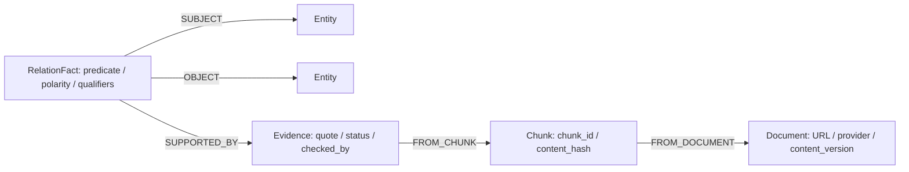

# Neo4j GraphRAG: triển khai và demo

Cập nhật 05/11/2026: snapshot đang dùng có 6 tài liệu, 67 chunk, 37 Entity,
38 RelationFact và 40 Evidence. Xem [bản nâng cấp](development_upgrade.md) để dùng
đồ thị ngay trên giao diện. Các số liệu 58 chunk ở phần kiểm chứng dưới đây là
mốc lịch sử 03/11; các truy vấn theo snapshot active vẫn dùng được.

Đã kiểm chứng ngày 03/11/2026 trên database thật: Neo4j Community **2026.10.1**,
Python Driver **6.4.0**. Graph tham gia truy xuất; ChromaDB vẫn giữ vector.
Không gọi lại Gemini Embedding khi migration. NetworkX chỉ còn để đối chiếu/rollback.

## Khởi động trên Windows

Mở Docker Desktop, chờ Engine sẵn sàng. Tại thư mục dự án:

```powershell
.\.venv\Scripts\python -m pip install -r requirements.lock.txt
powershell -ExecutionPolicy Bypass -File scripts/run-neo4j.ps1
```

Script tạo mật khẩu local ngẫu nhiên nếu chưa có trong `.env`, khởi động Compose,
đợi healthcheck rồi migration snapshot đang active. Chạy lại an toàn. Nếu volume
đã có mật khẩu khác, phải dùng mật khẩu của volume đó; không xóa volume để sửa lỗi đăng nhập.
Không chạy `docker compose config` để chia sẻ log vì nó có thể hiển thị secret đã nội suy.

Browser: **http://localhost:17474**. Bolt: **bolt://127.0.0.1:7687**.
Username `neo4j`; mật khẩu là trường `NEO4J_PASSWORD` trong `.env` của máy mình.
Windows máy hiện tại dành riêng dải 7389–7488 nên không bind được cổng 7474;
Compose dùng 17474. Có thể đổi `NEO4J_HTTP_PORT`/`NEO4J_BOLT_PORT`; khi đổi Bolt,
phải cập nhật cả `NEO4J_URI`. Chỉ mở các cổng trên loopback.

Muốn chạy riêng từng bước:

```powershell
.\.venv\Scripts\python -X utf8 -m ingestion.setup_neo4j
docker compose --progress quiet -f compose.neo4j.yml up -d --wait --wait-timeout 90
.\.venv\Scripts\python -X utf8 -m ingestion.migrate_neo4j
```

Tài nguyên cấu hình: 2 CPU, container tối đa 2 GiB, heap 256–512 MiB, page cache
256 MiB. Một lần đo sau migration/test khoảng **695 MiB** RAM container; không
phải tổng RAM Docker Desktop hoặc toàn ứng dụng. Không cài APOC/GDS.

Image digest đã tải:
`neo4j@sha256:44ad2a2504fd7d27df1d1e976f2d481e4266a0814d3657f2d5df62124ce657f1`.

## Cấu hình thực tế

Trong `.env` local đã chọn:

```dotenv
GRAPH_BACKEND=neo4j
ENABLE_GRAPH_RETRIEVAL=true
ENABLE_HYBRID_SEARCH=false
ENABLE_WIKI=false
ENABLE_RERANKING=false
FUSION_POLICY=vector_guarded
NEO4J_URI=bolt://127.0.0.1:7687
NEO4J_USER=neo4j
NEO4J_DATABASE=neo4j
```

Giữ `NEO4J_PASSWORD` của máy, không copy mật khẩu vào báo cáo. Gemini key/model
hiện có được giữ nguyên. `.env.example` vẫn để cờ truy xuất nâng cao tắt để máy
mới chỉ bật sau khi đã chạy migration/kiểm tra. Restart API nếu API đã chạy trước
khi đổi `.env`, vì cấu hình và Workflow có cache trong process.

## Schema và ý nghĩa số lượng

Snapshot thực tế:
`f70e5a9bc1bd55ff0e832eb266438204743f539f63ae62b0724912410f366b86`.

| Nhóm | Số bản ghi trong snapshot |
| --- | ---: |
| Entity | 36 |
| RelationFact | 36 |
| Evidence | 38 |
| Chunk | 58 |
| Document | 5 |
| GraphSnapshot | 1 |
| Cạnh cấu trúc | 206 |

**36 phát biểu y khoa khác với 206 cạnh cấu trúc.** Các cạnh SUBJECT, OBJECT,
SUPPORTED_BY, FROM_CHUNK, FROM_DOCUMENT diễn tả cấu trúc và provenance.



Giữ ontology, alias, predicate và ID gốc. Không ép mọi quan hệ về ASSOCIATED_WITH.
Ví dụ CANNOT_DIAGNOSE đã chứa nghĩa phủ định; polarity positive khẳng định chính
mệnh đề đó, không biến thành CAN_DIAGNOSE. Giữ qualifiers khi đưa vào trace/UI.

Neo4j không nối node Evidence trực tiếp vào một cạnh, nên dùng RelationFact làm
node trung gian để lưu nhiều chứng cứ độc lập. Browser hiển thị tên predicate
trên node RelationFact; các cạnh cấu trúc có nhãn riêng.

Node có `uid` vật lý được băm từ snapshot/label/ID logic, và giữ `entity_id`,
`relation_id`, `evidence_id`, `document_id`, `chunk_id` như cũ. Hai snapshot có thể
chứa cùng ID logic mà không ghi đè nhau. Constraints uniqueness dùng được trên
Community. Không bịa description, ngôn ngữ alias hay thời điểm thu thập còn thiếu.
`checked_by=codex_source_alignment_not_clinical_review` là đối chiếu nguồn bằng
agent, **không phải bác sĩ/chuyên gia đã duyệt**.

## Migration, cập nhật và rollback

Migration kiểm tra checksum/schema/corpus với Chroma, rồi ghi toàn snapshot trong
một write transaction. Đọc lại toàn bộ node/properties/cạnh trước khi đặt ready.
Lỗi sẽ rollback transaction. Chạy lại chỉ kiểm chứng snapshot đã có, không ghi đè.

Corpus hiện nhỏ nên mỗi graph snapshot mới được lưu đầy đủ để giữ lịch sử; đây
không phải cập nhật từng dòng graph trong snapshot đang phục vụ. Vector của nội
dung không đổi vẫn được tái sử dụng. Các snapshot cũ và collection cũ giữ nguyên.

`build_retrieval_indexes --activate` và `publish_corpus(..., activate=True)` nay
phải migration Neo4j thành công trước khi đổi `active.json`. Publisher hiện có
tạo Chroma staging, tái sử dụng vector và xây BM25/graph cùng phiên bản.
Khi thay nội dung NIDDK, dùng publisher này với Document đã qua loader và annotation
đã kiểm tra lại; không sửa trực tiếp collection active để cập nhật nhiều index.
Đây là hàm Python cho publisher tổng quát. CLI `python -m ingestion.publish_corpus`
hiện chỉ nhập wiki theo manifest; chưa có lệnh CLI thay NIDDK/PDF/DOCX/TXT qua publisher.
`index_documents` là luồng cũ cập nhật Chroma từng tài liệu; nếu nó đổi corpus mà
chưa công bố snapshot mới, enhanced retrieval sẽ từ chối snapshot cũ và fallback.

`migrate_neo4j --snapshot-id <id>` chỉ import/kiểm chứng, **không đổi active**.
Để rollback graph backend, đặt `GRAPH_BACKEND=networkx` rồi restart API. Nếu cần
quay về vector, tắt cả `ENABLE_GRAPH_RETRIEVAL`, `ENABLE_HYBRID_SEARCH`, `ENABLE_WIKI`
và `ENABLE_RERANKING`, rồi restart. Local hiện chỉ bật graph nên riêng việc tắt
graph đã đủ. Đổi backend không đổi corpus hoặc snapshot đang active.
`migrate_neo4j --snapshot-id` không phải lệnh rollback corpus; chưa có CLI riêng để
chuyển con trỏ về snapshot cũ. Không xóa Chroma hoặc Neo4j để rollback.

## Cypher dùng để demo

Trong Browser, khai báo tham số (sửa sid khi công bố phiên bản khác):

```text
:param sid => 'f70e5a9bc1bd55ff0e832eb266438204743f539f63ae62b0724912410f366b86'
:param entity_id => 'a1c_test'
:param relation_id => '00c01e24406d26b61534ec3a'
```

Copy từng query trong [neo4j_demo.cypher](neo4j_demo.cypher), gồm:

1. Tổng quan các phát biểu.
2. Nhóm diabetes.
3. Quan hệ của thực thể được chọn.
4. Evidence của phát biểu.
5. Đường tới Document gốc.
6. Hai bước quan hệ qua hai RelationFact.

Click node để xem properties, chọn nhãn Entity/RelationFact/Evidence/Chunk/Document
để đổi màu/caption trong Browser. Entity nên dùng caption `name`; RelationFact
dùng `predicate`; Document dùng `title`; Evidence dùng `evidence_id`.
Phân loại thực thể gốc nằm ở `entity_type` (test, condition, symptom...), có thể
lọc bằng Cypher. Không tạo node y khoa giả cho hình demo.

Đường hai bước chỉ hỗ trợ tìm tài liệu; không chứng minh một quan hệ y khoa mới
giữa hai đầu mút. Quote và điều kiện trong từng evidence mới là phần cần đối chiếu.

## Chứng minh hệ thống thực sự dùng Neo4j

Chạy API theo README. Mở `GET /api/v1/graph/stats`: endpoint truy vấn Neo4j thật,
trả trạng thái snapshot và số lượng node. `/retrieval-info` chỉ mô tả cấu hình và
snapshot local; không dùng endpoint đó thay cho kiểm tra database.

Qua Swagger, gọi `POST /api/v1/retrieve`:

```json
{
  "user_query": "Tiền tiểu đường liên quan nguy cơ típ 2 và thay đổi lối sống nào có thể giúp trì hoãn?",
  "retrieval_mode": "graph"
}
```

Kiểm tra `trace.graph.backend=neo4j`, `connected=true`, `query_count>0`,
`latency_ms`, `paths`, evidence IDs và `context_chunk_ids`. `used_in_context=true`
có nghĩa các chunk của đường đi thực sự vào ngữ cảnh. Response không sinh câu trả
lời LLM. Mode graph hiện là vector + graph; nếu query embedding lỗi vẫn có thể
dùng graph local. Mode hybrid_graph thêm BM25. Câu không có entity/ý định quan hệ
có thể không chạy Cypher (`connected=null`, `query_count=0`), không giả kết nối thành công.

Demo không gọi Gemini lại, dùng embedding query thật đã cache:

```powershell
.\.venv\Scripts\python -X utf8 -m evaluation.demo_graph --case-id r36 --output artifacts/graph_demo_neo4j.json
```

Kiểm tra fallback khi demo: dừng riêng service Neo4j bằng Compose, gọi lại endpoint,
quan sát `status=fallback` và warning. Khi Gemini khả dụng, vector vẫn trả kết quả.
Nếu cả embedding và local retrieval đều không có kết quả, giữ lỗi dịch vụ thật,
không báo nhầm rằng KB thiếu kiến thức. Sau đó khởi động lại Neo4j.

Ảnh đưa vào Overleaf: chụp tổng quan, đường fact→evidence→chunk→document và trace
HTTP có backend Neo4j. Ẩn `.env`/mật khẩu. Ghi rõ ảnh là truy xuất dữ liệu NIDDK,
không phải đồ thị chẩn đoán hay suy luận nhân quả.

## Tối ưu và kết quả

Neo4j dùng pool 4 kết nối/process, session riêng, read transaction timeout 2 giây,
write migration tối đa 30 giây, không retry dài trong request. Tối đa 8 thực thể
đầu vào, 2 bước quan hệ, 400 raw paths, 40 đường đã xếp hạng và 15 candidates.
Quy tắc xếp hạng dùng chung với NetworkX, chỉ nhận evidence khớp snapshot nguồn.
Sự cố database không làm dừng Prediction Agent hoặc vector/BM25.

Trước khi tối ưu fusion, Neo4j và NetworkX khớp **200/200 danh sách top-5** của
4 cấu hình × 50 câu; 2 cấu hình có graph trong đó dùng Cypher thật.

`vector_guarded` giữ tập top-k vector hợp lệ và dùng RRF để sắp xếp trong tập đó.
Nếu vector chưa đủ k hoặc không khả dụng, có thể bổ sung chunk graph/BM25.
Không cộng cosine, BM25 và graph scores. Khi đủ 5 vector, chính sách này chủ động
không mở rộng tập context ngoài top-5 vector; đây là đánh đổi để tránh mất evidence.
Reranker nếu bật là bước riêng, có thể thay đổi thứ tự/tập ứng viên; không bật trong
cấu hình đã chọn.

| Cấu hình cùng 58 chunk | Recall@5 | MRR | nDCG@5 |
| --- | ---: | ---: | ---: |
| Vector | 0,9778 | 0,8341 | 0,8617 |
| Vector + Neo4j, RRF cũ | 0,9333 | 0,8500 | 0,8722 |
| Vector + Neo4j, vector_guarded | 0,9778 | 0,8619 | 0,8919 |
| Vector + BM25 + Neo4j, vector_guarded | 0,9778 | 0,8193 | 0,8558 |

Chọn vector + Neo4j; BM25 làm giảm MRR trong thử nghiệm này nên giữ tắt. Graph
cải thiện r05/r07/r36/r42, vẫn giảm thứ hạng ở r21/r24; không tuyên bố mọi câu tốt hơn.
Không có gold evidence mới ngoài vector top-5 trên bộ này. Dữ liệu đánh giá gồm
50 câu (45 có gold, 5 thiếu bằng chứng), do agent gán và đã xem trong quá trình sửa;
không phải kiểm định mù/chuyên gia. Chưa đo groundedness hay chất lượng sinh câu
trả lời trong đợt migration. Latency dùng embedding cache, không phải chat end-to-end.
Reranker không đo lại A4 vì benchmark thực trước đó đã không đạt chất lượng/độ trễ.
Cache model reranker đã được dọn vì cấu hình hiện tại không dùng; nếu thử lại,
chạy `evaluation.benchmark_reranker --download` để tải lại. Báo cáo benchmark được giữ.
Wiki vẫn bị HTTP 403, chưa nhập tài liệu nào.

## Kiểm thử và tái lập

Lần kiểm tra khi dọn dự án ngày 03/11/2026 đã chạy **150 test Python**, gồm
**13 integration test Neo4j thật**, frontend build, Ruff và pip check. Có 6 cảnh báo
DeprecationWarning joblib/NumPy đã có từ trước. 5 test Playwright Edge đã đạt ở đợt
nâng cấp trước đó; không chạy lại trong lần dọn dẹp hoặc lần rà soát tài liệu này.
Ảnh/build/cache đã được dọn, các lệnh kiểm tra tương ứng sẽ tạo lại khi cần.

```powershell
$env:NEO4J_INTEGRATION='1'
.\.venv\Scripts\python -X utf8 -m pytest -o addopts='' -q --junitxml=artifacts/neo4j_test_results.xml
Remove-Item Env:\NEO4J_INTEGRATION
.\.venv\Scripts\python -X utf8 -m evaluation.evaluate_retrieval --graph-backend neo4j --fusion-policy vector_guarded --output artifacts/retrieval_ablation_neo4j_guarded.json
.\.venv\Scripts\python -X utf8 -m evaluation.neo4j_report
```

Nếu không bật NEO4J_INTEGRATION, 13 test database thật được đánh dấu skip; không
coi skip là kết nối thành công. Unit tests dùng corpus phần mềm nhỏ, không làm KB.
Playwright kiểm tra API Neo4j bằng NIDDK thật; attribution wiki ở UI dùng fixture,
không phải dữ liệu wiki đã tải. Thiếu query cache phải báo lỗi, không tạo vector giả.

## File thay đổi

- `backend/rag/neo4j_connection.py`, `neo4j_schema.py`, `neo4j_graph.py`: driver,
  schema và Cypher retrieval mới.
- `backend/rag/graph_backend.py`, `graph_search.py`: interface, ranking dùng chung.
- `knowledge_graph.py`, `snapshot.py`, `retriever.py`, `fusion.py`: validator,
  chọn backend, fallback và fusion bảo vệ top-k vector.
- `backend/core/config.py`, `backend/main.py`, `backend/api/routes.py`: cấu hình,
  lifecycle đóng driver, graph stats và trace.
- `ingestion/migrate_neo4j.py`, `setup_neo4j.py`, `build_retrieval_indexes.py`:
  migration, cấu hình local và chỉ activate sau khi Neo4j đã kiểm chứng.
- `evaluation/evaluate_retrieval.py`, `demo_graph.py`, `neo4j_report.py`: chọn
  backend/policy, demo có trace và tổng hợp báo cáo thực.
- `compose.neo4j.yml`, `scripts/run-neo4j.ps1`, `.env.example`, requirements
  base/lock: chạy local và dependency mới duy nhất `neo4j==6.4.0`.
- Frontend Answer/types/e2e: hiển thị backend, kết nối, latency, qualifiers/polarity;
  kiểm chứng API Neo4j thật và render attribution.
- `tests/test_neo4j.py`, `test_neo4j_integration.py`, conftest/pyproject: unit,
  integration opt-in và tách backend cũ trong fixture.
- README, architecture, tài liệu này và file Cypher demo.

Báo cáo: `artifacts/neo4j_upgrade_report.json`, `neo4j_migration.json`,
`retrieval_ablation_neo4j_rrf.json`, `retrieval_ablation_neo4j_guarded.json`,
`graph_demo_neo4j.json`, `neo4j_test_results.xml`. Snapshot JSON cũ và vector baseline
được giữ nguyên để rollback/đối chiếu; không cần train hay reindex toàn corpus.

Tài liệu thư viện: [Driver và tương thích](https://neo4j.com/docs/python-manual/current/install/),
[Docker Community](https://neo4j.com/docs/operations-manual/current/docker/introduction/),
[Uniqueness constraints](https://neo4j.com/docs/cypher-manual/current/schema/constraints/create-constraints/).
